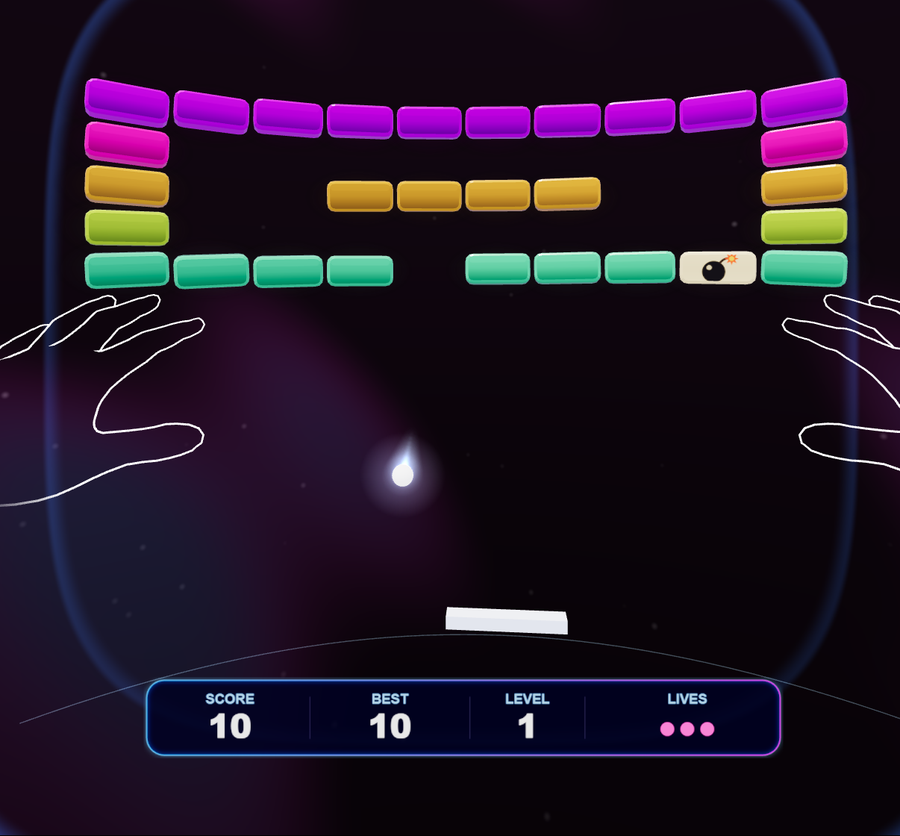
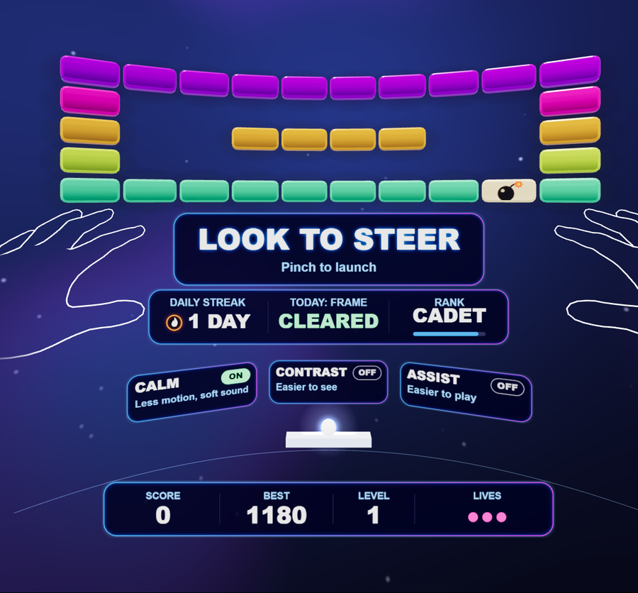

# ️Gaze Breaker

Brick-breaker where **your eyes are the paddle**. Built for Meta VR Glasses and Meta Quest with the
Immersive Web SDK (WebXR). 👀 Look to steer, 🤏 pinch to launch. Every brick you break plays a note in
space, and chaining bricks without touching the paddle climbs a pentatonic scale 🎵.

|                          First screen                           |                       In play (fireball power-up)                        |
| :-------------------------------------------------------------: | :----------------------------------------------------------------------: |
|  |                |
|             **Calm mode** (soft sky, ambient sound)             |              **Contrast mode** (patterns, not just colour)               |
|                  |  |

_These are real screenshots from the Immersive Web Emulator (Meta VR Glasses profile), not mock-ups._

## 🎮 How to play

- **Look** at where you want the paddle. It follows your gaze.
- **Pinch** (either hand) to launch the ball. Nothing starts until you do.
- Break the wall. Chains without touching the paddle multiply your score and raise the pitch.
- You have 3 lives. Clearing a wall starts a denser one with a faster ball (up to level 10), in a new colour world.
- **Daily wall:** the layout is seeded by the UTC date, so everyone plays the same wall on the same day.
  Your best score is saved on your device.
- **TNT bricks** (striped like caution tape) blow up everything around them, and set off other TNT bricks in a chain.
- **Power-ups** drop from some bricks: wide paddle, slow motion, fireball.

## ✨ Design notes

- 🙌 **Hands-first, no controllers needed.** Gaze steers, a hand pinch is the only button.
- 🪑 **Seated, field-of-view aware.** The playfield is about 65° wide, sitting level with and just below the
  eyes, inside the Meta VR Glasses view (37° left/right, 25° up, 43° down).
- 🔁 **Input fallbacks.** Eye gaze if the device provides it; otherwise head direction in a headset; mouse
  on a plain desktop page.
- ♿ **Accessibility options** (shown between rounds; look at one for a second, or pinch it; saved on your device):
  - 🌙 **Calm**: no shake, pulsing or fast background motion; a soft dusk sky; the beat is swapped for ambient chords and chimes.
  - 🔲 **Contrast**: near-black sky, a different pattern on each row of bricks (so colour is never the only cue), black-and-white cards.
  - 🛟 **Assist**: slower ball, wider paddle, 5 lives.
- 🔥 **A reason to come back.** One wall per day, the same for everyone, and each wall is a hand-drawn shape
  (heart, invader, diamond, frame, funnel, waves). Clear today's wall to keep your **daily streak**; a missed
  day resets it. Breaking bricks raises a lifetime **rank** (Cadet, Pilot, Ace, Commander, Legend) that only
  ever grows. Streak, rank and best score are saved on the device.
- 🎧 **Spatial audio.** Each brick's note is positioned at the brick (Web Audio HRTF panner), over a four-on-the-floor
  beat that speeds up from 120 to 140 BPM as the levels climb.
- ⚡ **Performance.** About 100 draw calls and 34k triangles per frame (the per-brick glow and shadow are instanced).
  Measured in the emulator only, not on a headset.

## 🚀 Run it

```sh
npm install
npm run dev     # opens the managed browser with the Immersive Web Emulator (Meta VR Glasses profile)
npm run build   # static site in dist/
node check-breaker.ts   # game-rules self-check (Node 22.6+)
```

In the emulator, choose **Gaze + Hands** input and use _Enter XR_.

## 🛠️ Tech

TypeScript, [Immersive Web SDK](https://iwsdk.dev) (Three.js, ECS), Web Audio. Game rules live in
`src/breaker-core.ts` (no 3D dependencies, covered by `check-breaker.ts`); rendering, input and sound
are in `src/breaker.ts`.

## 🔍 Honest limitations

- Tested in the Immersive Web Emulator's Meta VR Glasses profile (synthetic gaze), not on physical
  glasses, so real eye-tracking feel, audio on a headset and frame rate on Quest hardware are unverified.
- The earlier prototype in `src/hum.ts` and `src/echo.ts` (a gaze-playable step sequencer) is unused.

## 🤖 AI assistance

Built with help from Claude Code (Anthropic).
