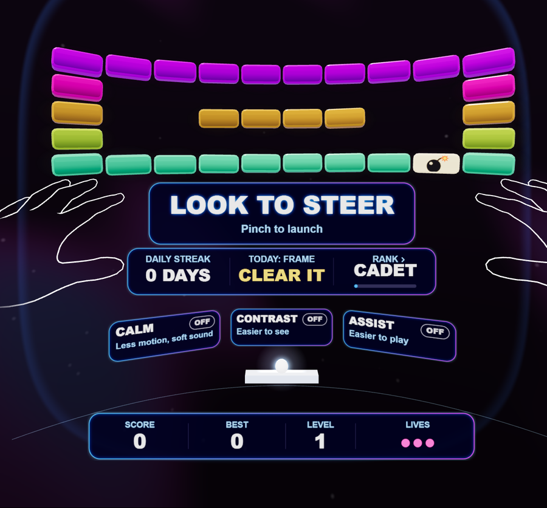
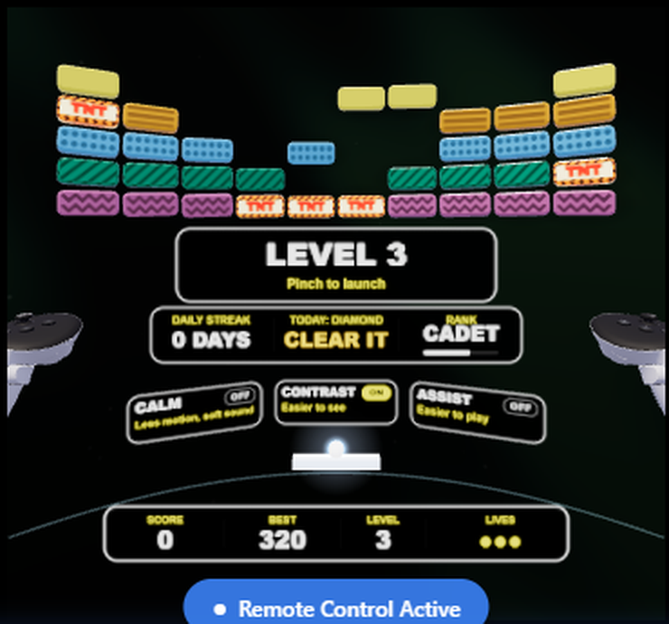

# Gaze Breaker 🔫

A brick-breaker where your gaze is the paddle, built for Meta VR
Glasses (and Meta Quest) with the Immersive Web SDK (WebXR). Look to steer, pinch to launch. Every brick
plays a note in space, and chaining bricks without touching the paddle climbs a pentatonic scale. So yes,
you're making music by staring at things.

|                          First screen                           |                       In play (fireball power-up)                        |
| :-------------------------------------------------------------: | :----------------------------------------------------------------------: |
|  |                |
|             **Calm mode** (soft sky, ambient sound)             |              **Contrast mode** (patterns, not just colour)               |
|                  |  |

_Real screenshots from the Immersive Web Emulator (Meta VR Glasses profile)._

## 🎮 How to play

- 👀 **Look** where you want the paddle. It goes there.
- 🤏 **Pinch** (either hand) to launch the ball. Nothing starts until you do, so take your time.
- Break the wall. Chains without touching the paddle multiply your score and raise the pitch.
- You get 3 lives. Clear a wall and you get a denser one, a faster ball (up to level 10) and a new colour world.
- 📅 **Daily wall:** the layout is seeded by the UTC date, so everyone plays the same wall on the same day.
  Your best score is saved on your device.
- 💣 **Bomb bricks** (pale, with a cartoon bomb on them) blow up everything around them, and set off other
  bomb bricks in a chain. Chemistry, basically.
- ⚡ **Power-ups** drop from some bricks: wide paddle, slow motion, fireball.

## ✨ Design notes

- **Hands-first, no controllers needed.** Gaze steers, a hand pinch is the only button. A round takes a
  few minutes, seated.
- **Field-of-view aware.** The playfield is about 65° wide and sits level with and just below the eyes,
  inside the Meta VR Glasses view (37° left/right, 25° up, 43° down).
- **Input fallbacks.** Eye gaze if the device has it, otherwise head direction in a headset, mouse on a
  plain desktop page. A controller trigger launches too.
- **Accessibility is in the game, not a patch.** Options show between rounds. Look at one to highlight it,
  pinch to switch it (so a stray glance can't flip a setting). Saved on your device.
  - **Calm:** no shake, pulsing or fast background motion; a soft dusk sky; the beat is swapped for
    ambient chords and chimes.
  - **Contrast:** near-black sky, a different pattern on each row of bricks (colour is never the only
    cue), black-and-white cards.
  - **Assist:** slower ball, wider paddle, 5 lives.
- **A reason to come back that isn't a notification.** One wall per day, the same for everyone, each a
  hand-drawn shape (heart, invader, diamond, frame, funnel, waves). Clear today's wall to keep your
  **daily streak**; miss a day and it resets. Breaking bricks raises a lifetime **rank** (Cadet, Pilot,
  Ace, Commander, Legend) that only ever goes up. Streak, rank and best score live on the device.
- **Spatial audio.** Each brick's note is positioned at the brick (Web Audio HRTF panner), over a
  four-on-the-floor beat that speeds up from 120 to 140 BPM as the levels climb.
- **Performance.** About 100 draw calls and 34k triangles per frame (the per-brick glow and shadow are
  instanced). Measured in the emulator only, not on a headset.

## 🚀 Run it

```sh
npm install
npm run dev     # opens the managed browser with the Immersive Web Emulator (Meta VR Glasses profile)
npm run build   # static site in dist/
node check-breaker.ts   # game-rules self-check (Node 22.6+)
```

In the emulator, choose **Gaze + Hands** input and use _Enter XR_.

## 🧰 Tech

TypeScript, [Immersive Web SDK](https://iwsdk.dev) (Three.js, ECS), Web Audio. Game rules live in
`src/breaker-core.ts` (no 3D dependencies, covered by `check-breaker.ts`); rendering, input and sound
are in `src/breaker.ts`.

## 🔍 Honest limitations

I don't have glasses or a Quest, so everything was tested in the emulator. In the Meta VR Glasses profile
I checked gaze steering, a pinch from each hand, the head-direction fallback with gaze disconnected, a
controller trigger, and that every panel sits inside the glasses' view. What the emulator can't tell me:

- How real eye tracking feels (the emulator's gaze is perfectly steady; real eyes are not).
- How it sounds and runs on actual hardware, including frame rate on Quest.
- How real hand tracking behaves when it loses your fingers.

## 🤖 AI assistance

Built with help from Claude Code (Anthropic).
